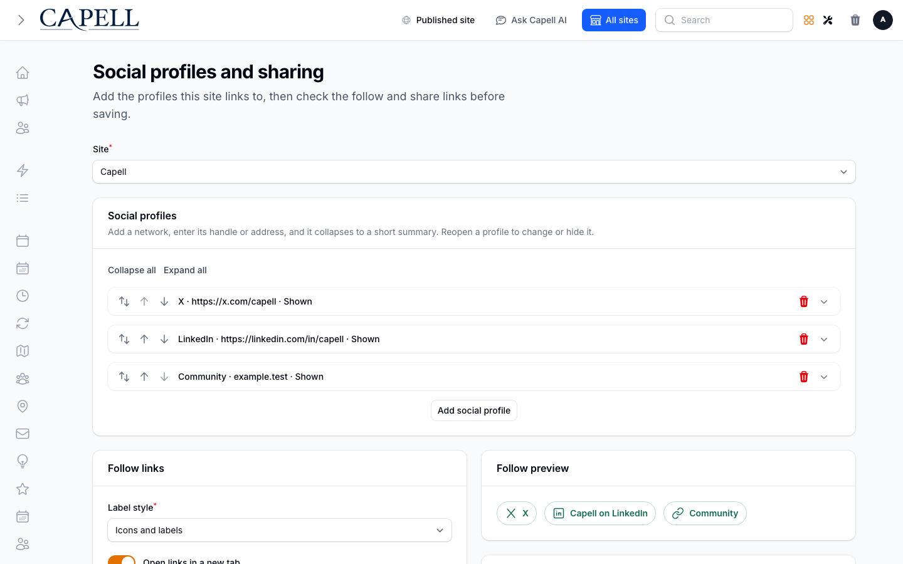
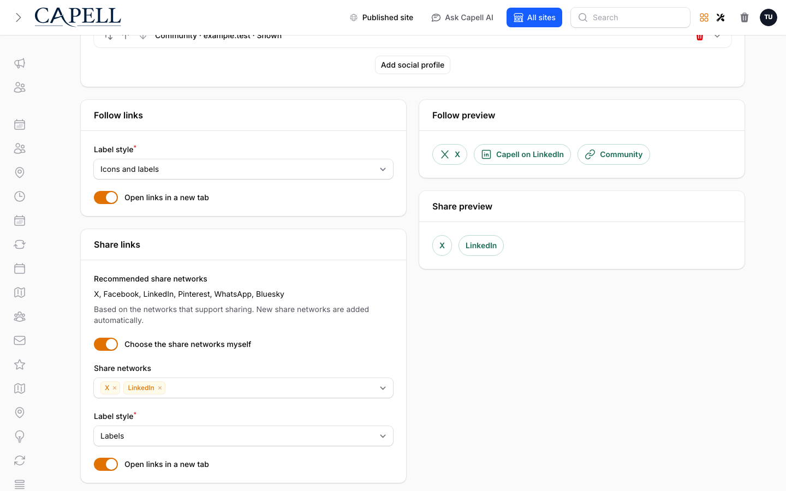

# Socials

<!-- prettier-ignore-start -->

## What It Does

Socials adds site-scoped registered and custom social profiles, shared follow and share defaults, and an explicit Block Library widget.

- **Price and availability:** Check current availability and price on the [Capell Marketplace listing](https://capell.app/extensions/socials).
- **Licence:** Check the licence terms on the [Capell Marketplace listing](https://capell.app/extensions/socials).
- **Requires:** `PHP ^8.4`, `capell-app/admin ^1.0.66`, `capell-app/block-library ^1.0`, `capell-app/core ^1.0.75`, `capell-app/frontend ^1.0`, `laravel/framework ^12.61.1|^13.12.0`, `lorisleiva/laravel-actions ^2.8`, `spatie/laravel-package-tools ^1.14.1`.
- **Install:** `composer require capell-app/socials`.

Admins manage profiles and previews on the Socials page, then editors place follow or share links on selected pages. Visitors receive accessible links without social SDKs or tracking scripts.

## Who It Is For

**For developers:** The network registry, public resolver contract, and typed render data keep profile validation separate from admin forms and public rendering.

**For teams:** Teams can approve social profiles once per site, reuse them in follow blocks, and offer canonical page sharing without embedding third-party scripts.

## Quick Start

1. Install the package: `composer require capell-app/socials`.
2. Run the package setup: `php artisan capell:socials-install`.
3. Open the package admin surface at `/admin/socials` and confirm Socials is available.

## Configure

- **Commands:** `php artisan capell:socials-install`.

## Limits And Pitfalls

- Install the required Capell packages at the versions in `composer.json`: `capell-app/admin ^1.0.66`, `capell-app/block-library ^1.0`, `capell-app/core ^1.0.75`, `capell-app/frontend ^1.0`.
- Run migrations before opening package resources or public routes.
- Keep public Blade and cached HTML free of authoring markers, model IDs, permissions, signed editor URLs, and lazy database queries.
- Custom write integrations must preserve invalidation for `socials` cache tags.

## Screens And Workflow

- Site-scoped Socials management (admin).
- Follow and share appearance beside the unsaved preview (admin).
- Accessible follow widget output (frontend).
- Unsaved follow and share preview (admin).
- Socials validation and save error state (admin).
- Canonical share widget output (frontend).
- Developer registry extensibility (shared).
- Site-scoped Socials management with admin sidebar menu open (admin).

## Works With

No optional companion integrations are currently declared with executable evidence.

## Install Impact

- Required packages: `capell-app/core`, `capell-app/admin`, `capell-app/frontend`, `capell-app/block-library`.
- Admin navigation: declares `admin-page: SocialsAdminPageContribution`; each Filament page or resource controls its own navigation visibility.
- Admin/editor extensions: none declared.
- Permissions: `View:SocialsPage`.
- Public routes: none declared.
- Database changes: package migrations are declared.
- Config: no package config files.
- Settings: no package settings declared.
- Queues or schedules: none declared.
- Cache tags: `socials`.
- Commands: `capell:socials-install`.

## Troubleshooting

| Symptom | Likely cause | Check | Fix |
| --- | --- | --- | --- |
| Package surface is missing after install | Provider or manifest is not loaded | Confirm `capell.json`, package `composer.json`, and provider registration | Reinstall the package, refresh Composer autoload, and clear host caches |
| Admin screen or command fails on missing table | Package migrations have not run | Check the tables listed in `Data Model` | Run host migrations and rerun the focused package test |
| Public output leaks unexpected state | Render data, cache variation, or authoring boundary has regressed | Check public Blade, cache tags, and public-output safety tests | Move data loading out of Blade and rerun the package public-output tests |

## Upgrading

No manual steps between minor versions.

## Next Steps

- [Package docs](docs/README.md)
- [Overview](docs/overview.md)
- [Worked extension examples](docs/extension-contracts.md)
- [Troubleshooting](#troubleshooting)
- [Developer reference](docs/reference.md)
- [Marketplace assets](docs/assets/marketplace/)
- [Capell content language plan](../../docs/CONTENT_LANGUAGE_PLAN.md)
- [Capell documentation design system](../../docs/DESIGN_SYSTEM.md)
- [Capell and package ERD notes](../../docs/erd/capell-and-package-erds.md)
- Related packages: [Block Library](../block-library/README.md).

<!-- prettier-ignore-end -->
